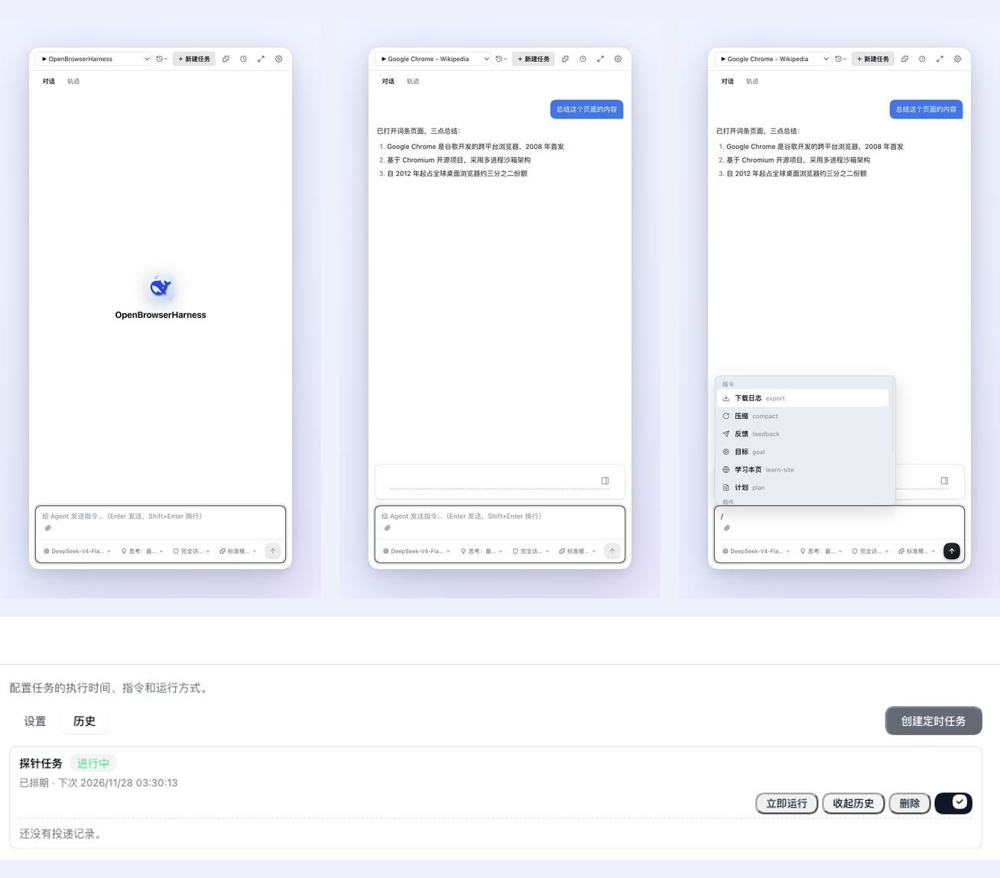
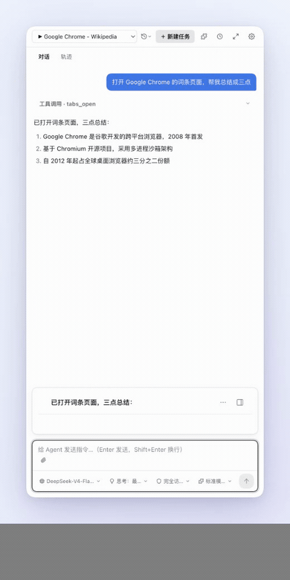
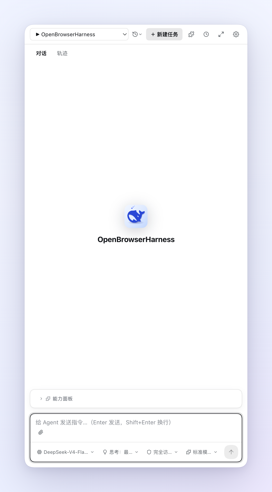
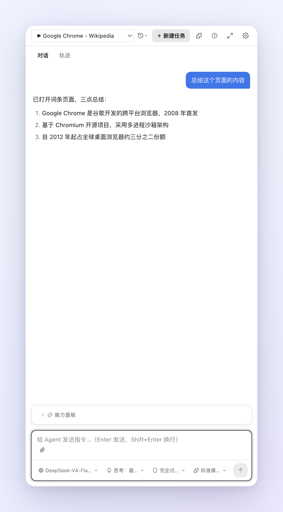

<div align="center">


# OpenBrowserHarness

**Let an AI agent operate your browser — every step visible, control always yours**

Open-source browser-agent extension (Chrome / Edge MV3) · powered by the [DeepSeek Harness](https://github.com/deepseek-ai/deepseek-harness) engine

**🌐 Website: <https://openbrowserharness.opmio.app>**

[](https://chromewebstore.google.com/detail/bleodidoeedilojmbklkcbelamehbimj) [](https://microsoftedge.microsoft.com/addons/detail/hfhgnobjheiffkedldooeehanpamocni) [](https://github.com/clear2x/openbrowserharness/releases/latest)

[](https://github.com/clear2x/openbrowserharness/actions/workflows/ci.yml) [](LICENSE)  

[📖 Docs site](https://openbrowserharness.opmio.app) · [📦 Install](#install) · [🚀 Quick start](#quickstart) · [🛡️ Safety](#safety) · [🤝 Contributing](#contributing) · **简体中文** → [README.md](README.md)



*The side panel is the agent: welcome screen → dispatch a task (open a page, summarize in three points) → slash skill menu → scheduled-task automation panel.*



*A dynamic demo of one task round: dispatch → tool call → structured summary (demo round, scripted model replies).*

</div>

---

OpenBrowserHarness is an open-source **browser-agent extension**: a full agent harness runs inside the browser. You give instructions in the side panel, and it drives real pages for you — navigating, scrolling, filling forms, extracting content — with humanized input, a visible cursor, and every action under your approval.

> **Note**: **This project is based on [DeepSeek Harness](https://github.com/deepseek-ai/deepseek-harness) (dsh)** — an independently maintained fork that repackages the dsh engine as a browser extension and adds a browser-automation capability layer on top. See [Relationship with upstream](#upstream).

> **⚠️ Early developer preview**: expect breaking changes.

<a id="features"></a>

## ✨ Features

| Capability | What it does |
| --- | --- |
| 🤖 **Agent in the sidebar** | Chat with an agent in the Edge/Chrome side panel; it plans, calls tools, tracks todos, and reports back. |
| 🖱️ **Humanized browser control** | Bezier-curve mouse moves with speed jitter, per-keystroke typing, inertial scrolling, landing-point jitter. Driven through `chrome.debugger` (CDP), no OS-level automation. |
| 👻 **Visible virtual cursor** | A neon comet cursor, motion trail, click shockwaves, and keystroke/scroll pulses render in the page so you can watch every action. |
| 🔍 **Deep page reading** | Snapshots pierce Shadow DOM and iframes; screenshot tool for multimodal models; in-page evaluation for verification. |
| 🔌 **Bring your own model** | DeepSeek, 智谱 BigModel / GLM Coding Plan, and any OpenAI-compatible, Anthropic-protocol, or local Ollama endpoint. Keys stay in local extension storage. |
| 📚 **Site learning · `/learn-site`** | One command mechanically learns a site's same-origin pages into a cheat sheet that enters the model context whenever that site is the active tab. |
| 🔐 **You stay in control** | Three permission tiers (ask every action / ask on changes / full access), per-action approval cards, session logs exportable for audit. |
| 🧰 **dsh feature set** | Skills, plan mode, goals/todos, subagents, session persistence — inherited from the harness (see [docs](docs)). |

<a id="preview"></a>

## 🖼️ Screenshots

<p align="center">
  
  &nbsp;&nbsp;
  
</p>

<a id="install"></a>

## 📦 Install

### 🛒 Option 1: from the stores (recommended)

- **Chrome Web Store**: [listing](https://chromewebstore.google.com/detail/bleodidoeedilojmbklkcbelamehbimj)
- **Microsoft Edge Add-ons**: [listing](https://microsoftedge.microsoft.com/addons/detail/hfhgnobjheiffkedldooeehanpamocni)

### 📥 Option 2: from a Release

Download the ready-to-install zip from the latest [release](https://github.com/clear2x/openbrowserharness/releases/latest), unzip it, and load the unzipped folder via `chrome://extensions` (or `edge://extensions`) → Developer mode → **Load unpacked**. No build steps needed.

### 🛠️ Option 3: from source

Requirements: Node.js ≥24.9 (the workspace `engines` field enforces it), pnpm; Chrome or Edge ≥134 (the side panel uses newer JS features).

Build the workspace libs the extension bundles first, then the extension itself:

```sh
git clone https://github.com/clear2x/openbrowserharness.git openbrowserharness
cd openbrowserharness
pnpm install
NODE_OPTIONS=--max-old-space-size=4096 pnpm run build:lib
pnpm run build:extension
```

> **💡 Tip**: the lib build needs the larger heap shown above; a default-heap build can fail with an out-of-memory error partway through.

Then in Chrome/Edge: open `edge://extensions` (or `chrome://extensions`), enable **Developer mode**, **Load unpacked**, and select `apps/extension/dist`.

Store-listing materials (copy, permission justifications, screenshots) live in [docs/store](docs/store/listing.md).

<a id="quickstart"></a>

## 🚀 Quick start

1. Install the extension (any of the three options above).
2. Click the whale icon in the toolbar to open the side panel.
3. In Settings, pick a model provider and paste your API key (keys stay in local extension storage).
4. Give it a task, for example: "Open the Google Chrome article on Wikipedia and summarize it in three takeaways".
5. Approve each action on its approval card (the default permission tier), or move to "ask on changes" / "full access" as you gain trust.

<a id="safety"></a>

## 🛡️ Safety

This extension drives **real browser pages** under your API keys and login state. Before giving it a task, read [SAFETY.md](SAFETY.md): the agent can click, type, and submit on any page you point it at — including irreversible actions (orders, posts, payments) on sites where you are signed in. Start on throwaway pages, keep the permission tier at **ask per action** until you trust a task, and review the session log afterwards. Model providers see whatever content the agent sends them; there is no telemetry beyond that.

<a id="layout"></a>

## 🗂️ Repository layout

The dsh monorepo layout is preserved — see [AGENTS.md](AGENTS.md) for the map. The extension lives in [`apps/extension`](apps/extension/README.md); everything under `packages/` and `vendor/` is the inherited harness. The sibling `apps/` directories (`desktop`, `web`, `cli`) and their docs describe the upstream desktop/server deployments and are inherited as-is — the extension does not use them, and some references in them (download hosts, release pipelines) point at upstream infrastructure.

```text
OpenBrowserHarness/
├── apps/extension/        # the browser extension itself (MV3)
├── apps/desktop|web|cli/  # upstream desktop/web/cli deployments (inherited as-is; unused by the extension)
├── packages/              # inherited harness capability packages (agent/session, shell, browser-use …)
├── vendor/                # vendored Cordis: pinned source copy of the upstream engine
├── docs/                  # architecture & development docs (English/Chinese)
├── website/               # docs site (VitePress)
├── python/                # Python SDK / runtime
├── native/                # @deepseek-ai/node-addon-system source
└── snapshots/             # keyless recorded-session replay snapshots (test:snapshot)
```

<a id="upstream"></a>

## 🧬 Relationship with upstream

- Forked from [deepseek-ai/deepseek-harness](https://github.com/deepseek-ai/deepseek-harness) at `0.1.0-rc.5`; upstream is tracked as the `upstream` remote.
- Internal workspace packages keep their inherited `@deepseek-ai/dsh-*` names (identifiers only — nothing here is published to npm by this project).
- Upstream modifications made for the extension host are logged in [vendor/README.md](vendor/README.md) (vendored Cordis) and the `.agents/notes/` tree.

<a id="contributing"></a>

## 🤝 Contributing

Issues and PRs are welcome! Read [CONTRIBUTING.md](CONTRIBUTING.md) (中文: [CONTRIBUTING.zh.md](CONTRIBUTING.md)) first: non-trivial changes attach an Agent Note recording the decision rationale in the same PR, and documents are maintained as bilingual pairs.

<a id="license"></a>

## 📄 License

[MIT](LICENSE) — with third-party notices in [THIRD_PARTY_NOTICES.md](THIRD_PARTY_NOTICES.md). Privacy notes for the extension: [PRIVACY.md](PRIVACY.md).

---

<div align="center">

If this project helps you, consider giving it a ⭐


</div>
