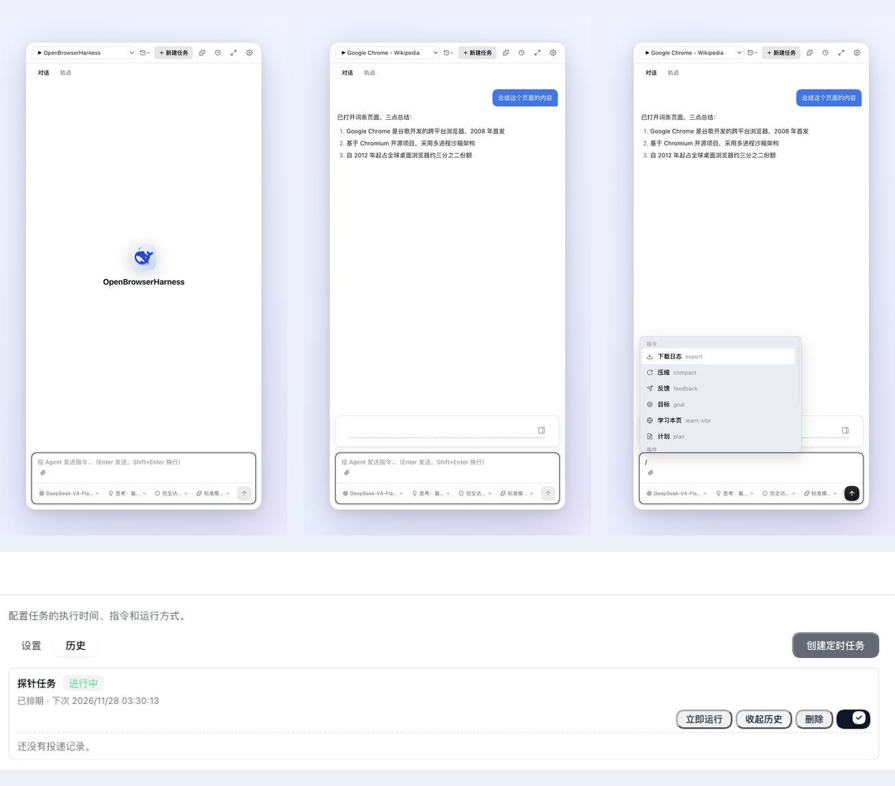
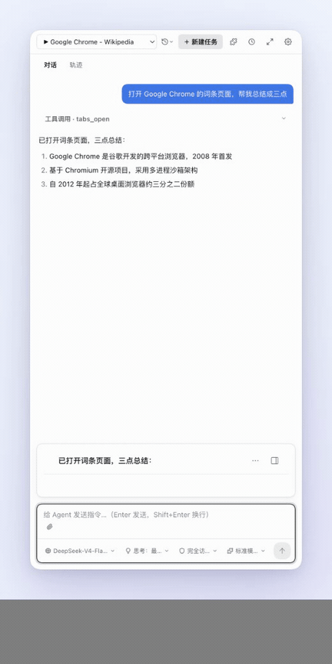

<div align="center">


# OpenBrowserHarness

**让 AI 智能体替你操作浏览器 —— 每一步都看得见，控制权始终在你手里**

开源浏览器智能体扩展（Chrome / Edge MV3）· 基于 [DeepSeek Harness](https://github.com/deepseek-ai/deepseek-harness) 引擎

**🌐 官网：<https://openbrowserharness.opmio.app>**

[](https://chromewebstore.google.com/detail/bleodidoeedilojmbklkcbelamehbimj) [](https://microsoftedge.microsoft.com/addons/detail/hfhgnobjheiffkedldooeehanpamocni) [](https://github.com/clear2x/openbrowserharness/releases/latest)

[](https://github.com/clear2x/openbrowserharness/actions/workflows/ci.yml) [](LICENSE)  

[📖 文档站](https://openbrowserharness.opmio.app) · [📦 安装](#install) · [🚀 快速开始](#quickstart) · [🛡️ 安全须知](#safety) · [🤝 参与贡献](#contributing) · **English** → [README.en.md](README.en.md)



*侧边栏即 Agent：欢迎页 → 派发任务（打开页面并三点总结）→ 斜杠技能菜单 → 定时任务自动化面板。*



*一轮任务的动态演示：派发 → 工具调用 → 结构化总结（演示轮次，脚本化模型回复）。*

</div>

---

OpenBrowserHarness 是一个开源的**浏览器智能体扩展**：完整的 agent harness 运行在浏览器里，你在侧边栏下指令，它驱动真实网页替你完成——导航、滚动、填表单、提取内容。输入拟人化、光标全程可视化，且每一个动作都受你审批。

> **注**：**本项目基于 [DeepSeek Harness](https://github.com/deepseek-ai/deepseek-harness)（dsh）二次开发**——一个独立维护的 fork，把 dsh 引擎重新打包为浏览器扩展，并在其上新增了浏览器自动化能力层。详见[与上游的关系](#upstream)。

> **⚠️ 早期开发者预览**：会有破坏性变更。

<a id="features"></a>

## ✨ 功能特性

| 能力 | 说明 |
| --- | --- |
| 🤖 **侧边栏里的智能体** | 在 Edge/Chrome 侧边栏与 agent 对话；它规划任务、调用工具、记录待办、汇报结果。 |
| 🖱️ **拟人化浏览器控制** | 贝塞尔鼠标轨迹带速度抖动、逐键输入、惯性滚动、落点抖动。通过 `chrome.debugger`（CDP）驱动，不依赖任何 OS 级自动化。 |
| 👻 **可视化虚拟指针** | 霓虹彗星光标、运动拖尾、点击冲击波、打字/滚动脉冲直接渲染在页面上，每一步操作都看得见。 |
| 🔍 **深度页面读取** | 快照穿透 Shadow DOM 与 iframe；截图工具供多模态模型使用；页内脚本执行用于结果验证。 |
| 🔌 **自带模型接入** | DeepSeek、智谱 BigModel / GLM Coding Plan，以及任意 OpenAI 兼容端点、Anthropic 协议端点、本地 Ollama。密钥只存本地扩展存储。 |
| 📚 **站点学习 `/learn-site`** | 一条命令机械式学习站点的同源页面，浓缩成速查表；该站点为活动标签页时自动进入模型上下文。 |
| 🔐 **控制权在你** | 三档权限（每次确认 / 仅变更确认 / 完全访问）、逐操作审批卡、会话日志可导出审计。 |
| 🧰 **dsh 完整特性** | skills、计划模式、目标/待办、子代理、会话持久化——继承自 harness（见 [docs](docs/)）。 |

<a id="install"></a>

## 📦 安装

### 🛒 方式一：应用商店（推荐）

- **Chrome Web Store**：[商店页面](https://chromewebstore.google.com/detail/bleodidoeedilojmbklkcbelamehbimj)（详情目前为英文）
- **Microsoft Edge Add-ons**：[商店页面](https://microsoftedge.microsoft.com/addons/detail/hfhgnobjheiffkedldooeehanpamocni)

### 📥 方式二：从 Release 下载

从最新 [Release](https://github.com/clear2x/openbrowserharness/releases/latest) 下载打包好的 zip，解压后在 `chrome://extensions`（或 `edge://extensions`）→ 开发者模式 → **加载解压缩的扩展** 中选择解压出的文件夹即可，无需构建步骤。

### 🛠️ 方式三：从源码构建

要求：Node.js ≥24.9（工作区 `engines` 字段强制此项），pnpm；Chrome/Edge ≥134（侧栏用到较新的 JS 特性）。

先构建扩展要打包的工作区 lib，再打包扩展：

```sh
git clone https://github.com/clear2x/openbrowserharness.git openbrowserharness
cd openbrowserharness
pnpm install
NODE_OPTIONS=--max-old-space-size=4096 pnpm run build:lib
pnpm run build:extension
```

> **💡 提示**：lib 构建需要上面这条更大的堆设置；默认堆可能在构建中途以内存不足失败。

然后在 Chrome/Edge 打开 `edge://extensions`（或 `chrome://extensions`），开启**开发人员模式**，**加载解压缩的扩展**，选择 `apps/extension/dist`。

商店上架材料（文案、权限论证、截图）在 [docs/store](docs/store/zh/listing.md)。

<a id="quickstart"></a>

## 🚀 快速开始

1. 安装扩展（上面三种方式任选其一）。
2. 点击工具栏里的鲸鱼图标，打开侧边栏。
3. 在设置里选择模型供应商，粘贴你的 API Key（密钥只存在本地扩展存储）。
4. 下一个任务，例如：「打开维基百科的 Google Chrome 条目，提炼三个要点」。
5. 在审批卡上逐个确认动作（默认权限档位），或者按需调整到「仅变更确认」/「完全访问」。

<a id="safety"></a>

## 🛡️ 安全须知

本扩展在你的 API Key 与登录态下驱动**真实网页**。交给它任务前先读 [SAFETY.zh.md](zh/SAFETY.md)：agent 会在你指定的页面上点击、输入、提交——包括登录状态下的不可逆操作（下单、发帖、支付）。先在一次性页面上试，信任一个任务前把权限档位保持在**每次确认**，事后回看会话日志。模型供应商能看到 agent 发送的内容；除此之外没有任何遥测。

<a id="layout"></a>

## 🗂️ 仓库结构

保留 dsh monorepo 结构——总览见 [AGENTS.md](AGENTS.md)。扩展本体在 [`apps/extension`](apps/extension/zh/README.md)；`packages/` 与 `vendor/` 之下是继承的 harness。同级的 `apps/` 目录（`desktop`、`web`、`cli`）及其文档描述的是上游桌面／服务器部署形态，按原样继承——本扩展不使用它们，其中部分引用（下载主机、发布流水线）指向上游基础设施。

```text
OpenBrowserHarness/
├── apps/extension/        # 浏览器扩展本体（MV3）
├── apps/desktop|web|cli/  # 上游桌面/Web/CLI 部署形态（按原样继承，本扩展不使用）
├── packages/              # 继承的 harness 能力包（agent/session、shell、browser-use …）
├── vendor/                # Vendored Cordis：上游引擎的钉定源码副本
├── docs/                  # 架构与开发文档（中英双语）
├── website/               # 文档站（VitePress）
├── python/                # Python SDK / runtime
├── native/                # @deepseek-ai/node-addon-system 源码
└── snapshots/             # 键录制的会话回放快照（test:snapshot）
```

<a id="upstream"></a>

## 🧬 与上游的关系

- Fork 自 [deepseek-ai/deepseek-harness](https://github.com/deepseek-ai/deepseek-harness)（`0.1.0-rc.5`）；上游以 `upstream` remote 追踪。
- 内部 workspace 包沿用继承的 `@deepseek-ai/dsh-*` 命名（仅标识符——本项目不向 npm 发布任何包）。
- 为扩展宿主所做的上游修改登记于 [vendor/README.md](vendor/README.md)（vendored Cordis）与 `.agents/notes/` 树。

<a id="contributing"></a>

## 🤝 参与贡献

欢迎 Issue 与 PR！动手前先读 [CONTRIBUTING.zh.md](zh/CONTRIBUTING.md)（English: [CONTRIBUTING.md](CONTRIBUTING.md)）：非平凡变更需在同一 PR 里附带一篇 Agent Note 记录决策理由，中英文档以双语对维护。

<a id="license"></a>

## 📄 许可证

[MIT](LICENSE)——第三方声明见 [THIRD_PARTY_NOTICES.md](THIRD_PARTY_NOTICES.md)。扩展隐私说明：[PRIVACY.md](PRIVACY.md)。

---

<div align="center">

如果这个项目对你有帮助，欢迎点一个 ⭐


</div>
